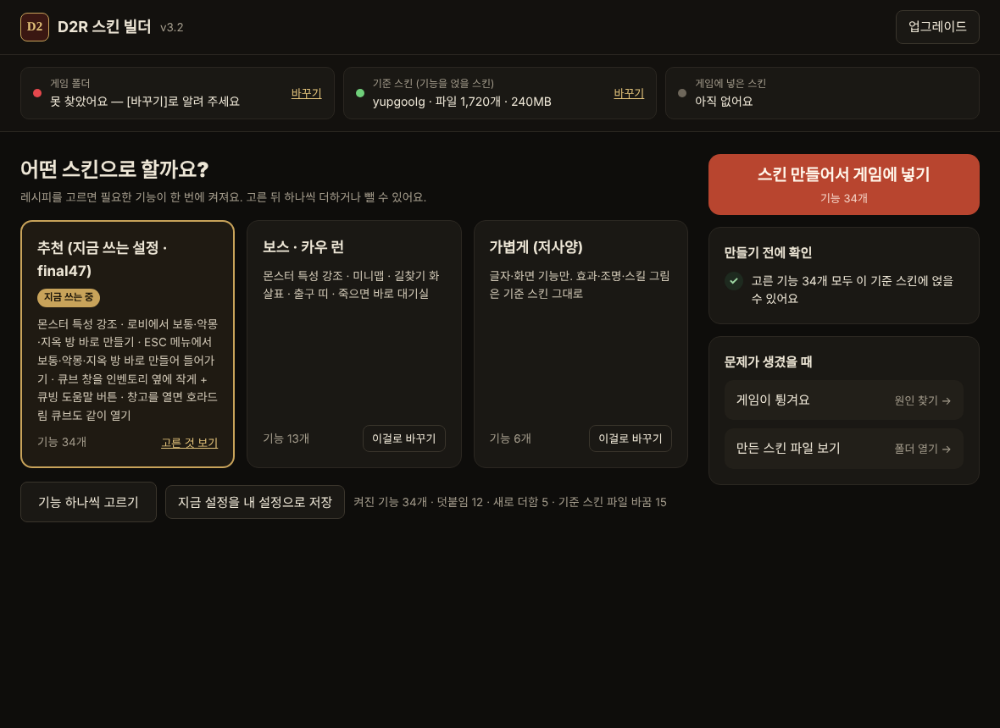
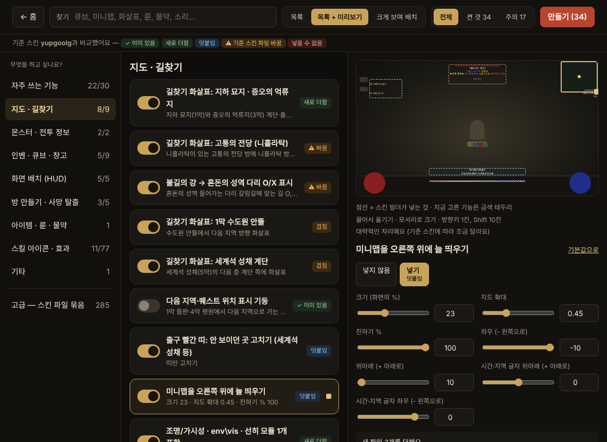
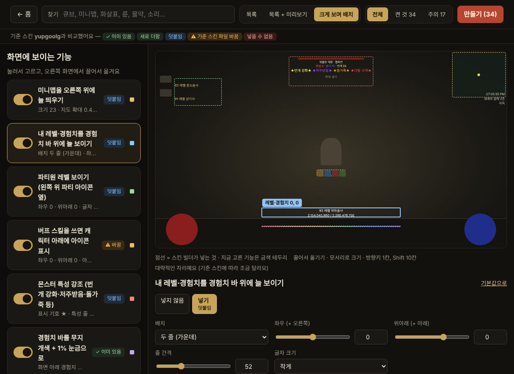
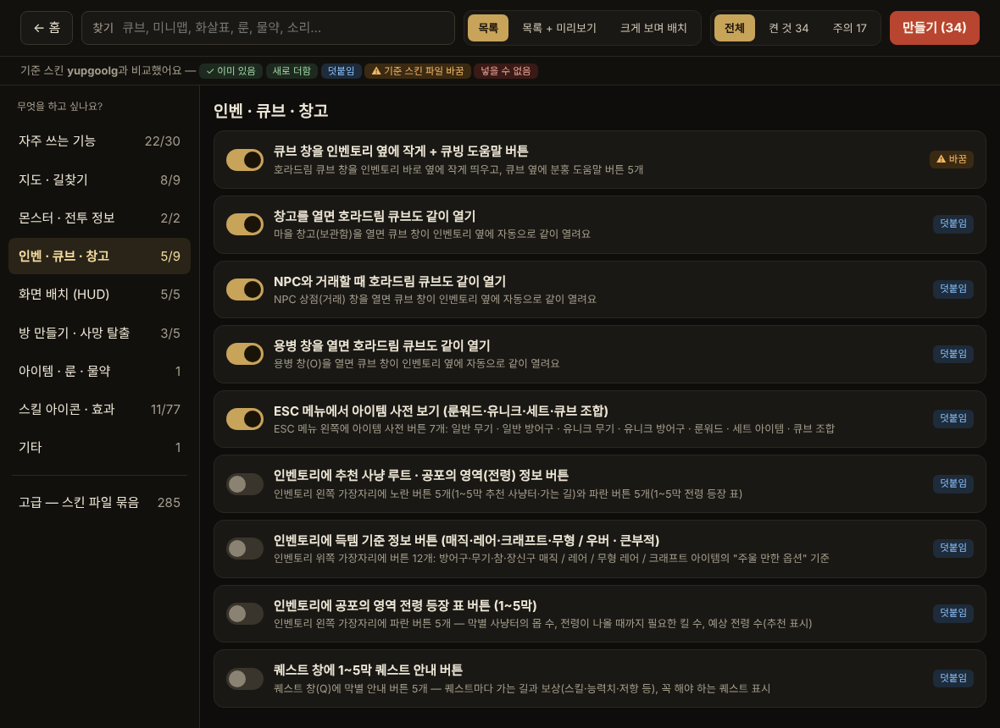
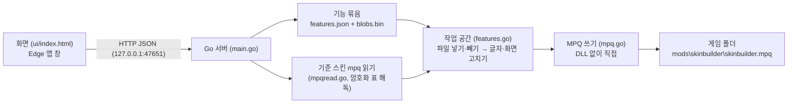

<div align="center">


# D2R 스킨 빌더

**디아블로 II 레저렉션 스킨(mpq)에 원하는 기능만 골라 얹는 프로그램**

쓰던 스킨은 그대로 두고, 여러 스킨에 흩어져 있던 편의 기능(미니맵 고정, 몬스터 특성 강조, 큐브 같이 열기,
죽으면 바로 대기실 등)을 골라서 **새 스킨 하나**로 만들어 게임에 넣어 줘요. 게임이 튕기지 않게 확인하는 장치까지 들어 있어요.

[내려받기 (Releases)](https://github.com/windkwk-rgb/wk-s-lab/releases?q=d2rskinbuilder&expanded=true) · [동작 원리](docs/ARCHITECTURE.md) · [직접 빌드하기](#직접-빌드하기)

</div>

---



## 주요 기능

| | |
|---|---|
| **기준 스킨에 얹기** | 기준 스킨 mpq 의 파일은 그대로 두고, 고른 기능의 "연산"만 덧붙여 새 mpq(`mods\skinbuilder`)를 만듦. 원래 스킨은 바뀌지 않음 |
| **기능 390여 개** | 직접 만든 기능 + 여러 스킨에서 가져온 화면·아이콘·효과 묶음. 기능마다 "무엇이 바뀌는지"를 쉬운 말로 설명 |
| **미리 비교** | 기준 스킨을 고르면 기능마다 `이미 있음 / 새로 더함 / 덧붙임 / 기준 스킨 파일을 바꿈 / 넣을 수 없음`을 미리 계산해서 표시 |
| **레시피로 바로** | 첫 화면에서 "보스·카우 런", "가볍게(저사양)" 같은 레시피를 고르면 필요한 기능이 한 번에 켜짐. 내 설정도 같은 자리에 카드로 |
| **목적별로 고르기** | 390여 개 기능을 "지도·길찾기 / 몬스터 / 인벤·큐브 / 화면 배치 / 방 만들기 …" 목적별로 나누고, 스위치 목록 + 오른쪽 상세 패널로. 스킨 파일 묶음은 "고급"으로 따로 |
| **게임 화면 미리보기** | 미니맵·레벨·경험치·파티원 레벨·버프 아이콘·대기실 버튼을 게임 화면 모양 위에서 **끌어서 옮기고** 모서리로 크기 조절. 움직이면 숫자 설정이 같이 바뀜 (방향키로 미세 조정) |
| **튕김 원인 찾기** | 게임이 튕기면 고른 기능을 반씩 나눈 시험 스킨을 차례로 넣고 "켜졌어요 / 튕겼어요"만 누르면 원인 기능을 찾아 줌 (같이 있을 때만 튕기는 경우도 구분) |
| **기준 스킨 새 버전 확인** | 기준 스킨이 지난번과 달라지면 바뀐 파일을 묶음별로 보여 주고, 고른 기능이 그대로 얹히는지 알려 줌 |
| **내 설정** | 고른 기능·숫자를 이름 붙여 여러 벌 저장·불러오기. 처음 켜면 추천 설정으로 시작 |
| **설치 프로그램 내장** | 파일 이름에 `setup` 이 들어간 exe 를 실행하면 설치 프로그램으로 동작. 관리자 권한 없이 설치하고, 시작 메뉴 · 바탕 화면 바로가기와 "설정 → 앱" 제거 등록까지. 설치 파일 뒤에 기준 스킨 mpq 를 붙여 두면 함께 풀어서 스킨 목록에 바로 보여 줌 |
| **업데이트** | 패치 파일(.sbpatch)로 기능·화면·프로그램을 새 버전으로. 배포한 **mpq 안에 업그레이드를 넣어** 두면 게임에 설치만 해도 프로그램이 스스로 새 버전이 됨 |

<table>
<tr>
<td></td>
<td></td>
</tr>
<tr>
<td align="center"><sub>기능 고르기 — 목적별 탭 · 스위치 목록 · 오른쪽에 미리보기와 상세 설정</sub></td>
<td align="center"><sub>크게 보며 배치 — 화면 위에서 끌어서 옮기면 숫자가 같이 바뀌어요</sub></td>
</tr>
<tr>
<td colspan="2"></td>
</tr>
<tr>
<td colspan="2" align="center"><sub>목록만 보기 — 기준 스킨과 비교한 결과(덧붙임 · 바꿈 · 이미 있음)가 기능마다 붙어요</sub></td>
</tr>
</table>

## 구조



- **연산(op) 방식**: 기능은 파일 묶음이 아니라 "이 파일을 넣어라 / 이 화면 위젯 children 끝에 붙여라 / 이 글자의 색을 바꿔라 / 기준 스킨 경험치 바 위치에 맞춰 숫자를 채워라" 같은 연산 목록이에요. 그래서 어떤 기준 스킨에도 덮어쓰지 않고 얹을 수 있어요.
- **같은 데이터는 한 번만**: 여러 기능이 같은 파일을 쓰면 sha1 로 한 번만 저장. 기능 데이터는 미리 압축해 둔 조각을 그대로 복사하고, 기준 스킨 파일도 압축된 그대로 옮겨서 다시 압축하는 건 고친 파일뿐이에요.
- 자세한 내용은 [동작 원리](docs/ARCHITECTURE.md)에 있어요.

## 기술 스택

`Go 1.24` `embed` `net/http` `MPQ v1 (직접 구현: 해시 표 암호화 · zlib 조각 압축)` `HTML/CSS/JS (프레임워크 없이)` `Python (도구)` `GitHub Actions`

## 사용 방법

1. [Releases](https://github.com/windkwk-rgb/wk-s-lab/releases?q=d2rskinbuilder&expanded=true)에서 `D2RSkinBuilder-setup-v….exe` 를 받아 실행하면 설치돼요
   (`%LOCALAPPDATA%\Programs\D2R스킨빌더`, 관리자 권한 필요 없음). 바탕 화면의 **D2R 스킨 빌더**를 실행하면 앱 창이 열려요.
2. **게임 폴더**를 확인하고, **기준 스킨**(쓰던 스킨 mpq)을 골라요.
3. **기능 고르기**에서 원하는 기능을 고르고 숫자를 조정해요. "추천대로 고르기"로 한 번에 고를 수도 있어요.
4. **스킨 만들어서 게임에 넣기**를 누르면 `mods\skinbuilder\skinbuilder.mpq` 가 만들어져요.
   배틀넷 게임 설정의 추가 명령줄 인수를 `-mod skinbuilder` 로 바꾸면 적용돼요 (화면에 복사 버튼이 있어요).
5. 게임이 튕기면 **게임이 튕겨요 (원인 찾기)** 를 눌러요.

> 이 저장소에는 **다른 제작자의 스킨 파일이 들어 있지 않아요.** 공개 빌드(Releases 의 예제판 설치 파일)는 직접 만든 기능 3개(몬스터 특성 강조 · 출구 표시 고치기 · 번개 강화 강조)만 담은 예제 묶음(`pack/sample`)으로 만들어져요.
> 실제 기능 묶음은 각자 가진 스킨에서 만든 `private/` 폴더에 두고 빌드해요.

## 직접 빌드하기

```bat
:: Windows — Go 가 없으면 winget 으로 설치한 뒤 dist\D2R스킨빌더.exe 와 설치 파일 dist\D2R스킨빌더_setup.exe 를 만들어요
build.bat
```

```bash
# 어디서나 (Go 1.24+)
go test ./...                                   # 작은 시험 스킨을 만들어 기능을 얹어 보는 시험
GOOS=windows go build -ldflags "-H windowsgui" -o D2R스킨빌더.exe .            # 예제 묶음
GOOS=windows go build -tags private -ldflags "-H windowsgui" -o D2R스킨빌더.exe .  # private/ 실제 묶음

# 개발용 명령줄
go run . --build 기준.mpq preset 결과.mpq       # 추천 설정으로 스킨 만들기
go run . --status 기준.mpq preset              # 기능마다 기준 스킨과 비교
go run . --diff a.mpq b.mpq                    # 두 mpq 의 다른 파일
```

| 도구 | 하는 일 |
|---|---|
| `tools/extract_pack.py` | 완성된 exe 안에서 기능 묶음(features.json · blobs.bin · 그림)을 꺼내 `private/` 에 되살림 |
| `tools/make_sample_pack.py` | 실제 묶음에서 다른 제작자 파일을 쓰지 않는 기능만 골라 `pack/sample` 을 만듦 |
| `--make-setup 프로그램.exe 결과_setup.exe 스킨.mpq…` | 프로그램 뒤에 기준 스킨들을 붙여 설치 파일 하나로 (개인 배포용, `payload.go`) |
| `tools/make_icon_syso.py` | `ui/icon.png` 로 exe 아이콘 리소스(`rsrc_windows_amd64.syso`)를 만듦 — 외부 도구 없이 COFF 를 직접 씀 |
| `tools/snapshot.py` · `tools/make_patch.py` | 배포한 전체판을 기준으로 저장해 두고, 바뀐 데이터만 담은 패치(.sbpatch)를 만듦 |
