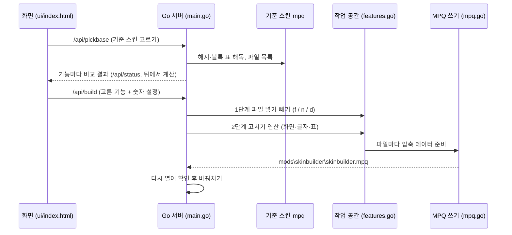

# 동작 원리

D2R 스킨 빌더가 어떻게 기준 스킨 위에 기능을 얹어 새 mpq 를 만드는지 정리한 문서예요.

## 전체 흐름

## 기능 묶음 (features.json + blobs.bin)

- `features.json` — 기능 목록. 기능 = `id`, `group`, `name`, `easy`(쉬운 설명 표), `options`(넣기/빼기 같은 선택지), `params`(숫자·색 설정).
  선택지마다 `ops`(연산 목록)를 가져요.
- `blobs.bin` — 기능이 쓰는 파일 내용. MPQ 에 그대로 넣을 수 있는 **조각 형태**(조각 위치 표 + zlib 조각 16KB)로 미리 압축돼 있어요.
  `blobs[i] = [위치, 압축 크기, 원래 크기]`, `sha[i]` 는 원래 내용의 sha1 (같은 파일인지 비교용).
- 예제 묶음은 `pack/sample`, 실제 묶음은 `private/` (빌드 태그 `private`). 패치로 받은 새 데이터는 `extra.bin` 에 있고
  위치가 기본 데이터 길이 이상이면 거기서 읽어요 (`blobData`).

## 연산(op) 종류

| 연산 | 하는 일 |
|---|---|
| `f` / `n` / `d` | 파일 넣기 (있으면 바꿈) / 없을 때만 넣기 / 빼기. **항상 먼저** 모두 실행 |
| `append_child` | 화면 파일 맨 바깥 위젯의 `children` 끝에 위젯 붙이기. 마지막 줄 끝 `//` 주석 뒤에 쉼표가 붙지 않게 주석을 피해서 넣음 |
| `append_in` | 이름이 `widget` 인 위젯 **안의** `children` 끝에 붙이기 |
| `insert_before` | 위젯 바로 앞에 끼우기. 기준 스킨의 다른 위젯 y 를 읽어 `{Y0}` `{Y1}` 자리에 채움 |
| `replace_span` | 위젯 `first` 부터 `last` 까지를 통째로 바꾸기 |
| `gen_file` | 새 화면 파일 만들기. `{MP_X}` 같은 자리에 화면 배치 숫자를 채움 (아래) |
| `regex_sub` | 정규식으로 고치기 (예: 출구 표시 상자 높이 25 → 60) |
| `set_style` · `shift_y` | 위젯 글자 크기 바꾸기 · 특성 줄이 커진 만큼 아래 줄 내리기 |
| `str_set` · `str_add` | 글자(strings) 바꾸기 · 없는 글자 더하기 (새 id 는 30001 부터, `onlymissing` 이면 있는 글자는 그대로) |
| `monster_mods` | 몬스터 특성 글자에 기호·색. 강조하지 않는 특성은 색을 지우고, 저항 줄 끝에 줄바꿈 |
| `table_set` · `glow` | 게임 데이터 표(txt) 칸 바꾸기 · 번개 강화 상태에 빛·몸 색 |
| `icon_shift` | 버프 아이콘 위치·간격·크기 옮기기 |
| `fit_sprite` · `copy_over` | 그림 크기가 맞을 때만 바꾸기 · 파일 복사해 덮기 |

연산이 기준 스킨 모양과 맞지 않으면 `else` 의 연산(보통 화면 파일 통째로 넣기)을 대신 해요.

## 화면 배치 숫자 (layoutTokens)

새 화면 파일은 기준 스킨의 배치를 읽어 숫자를 채워요. 예를 들어

- **파티원 레벨**: 기준 스킨 파티 아이콘 자리·간격(`hireablespanelhd.json`)과 원래 기능을 만든 스킨의 자리 차이만큼 옮김 → `{LX}` `{LY}` `{IH}`
- **내 레벨·경험치**: 기준 스킨 하단 바의 경험치 바(`ExpBar`) 가운데에 맞춤. 배치(두 줄·한 줄·양 끝)와 사용자가 고른 좌우·위아래·간격을 더함
- **미니맵**: 크기 %, 확대, 진하기, 위치 → `{MP_*}`. 시간·지역 글자는 지도 크기에 맞춰 바로 아래 → `{MI_X}` `{MI_Y}`

## MPQ 읽기·쓰기

- 읽기 (`mpqread.go`): 해시 표·블록 표를 `cryptTable` 로 해독, 이름 해시로 찾기, 조각마다 zlib 풀기, 암호화된 파일도 지원.
- 쓰기 (`mpq.go`): MPQ v1. 파일마다 블록 하나(같은 내용을 공유하면 일부 도구가 못 찾음), `(listfile)` 포함, 해시 표 크기는 파일 수의 2배 이상 2의 거듭제곱.
  기준 스킨 파일은 압축된 블록을 그대로 복사하고(조각 크기가 같을 때), 고친 파일만 다시 압축 (4개 동시).
- 만든 뒤 다시 열어 `modinfo.json` · `skinbuilder.json` 을 읽어 보고, 성공하면 이전 파일과 바꿔요.

## 업데이트

| 방법 | 설명 |
|---|---|
| 패치 파일 `.sbpatch` | zip: `manifest.json`(버전·기준) + 새 `features.json` + 새 데이터만 `extra.bin` + 바뀐 화면 + (있으면) 가벼운 `program.exe`. 프로그램 옆에 두면 켤 때 자동으로 넣음 |
| mpq 안 업그레이드 | 배포용 mpq 를 `SB_EMBED_PATCH=패치` 로 만들면 mpq 안에 `skinbuilder_update.sbpatch` 가 들어감. 게임 폴더에 설치된 mpq 나 프로그램 옆 mpq 가 더 새 버전이면 켤 때 스스로 업그레이드하고, 그 mpq 를 만든 설정을 지금 설정으로 (전 설정은 보관) |
| 가벼운 판 | 패치에 든 `program.exe` 는 기능 데이터 없이 빌드(`-tags slim`). 처음 패치할 때 전체판 데이터를 `스킨빌더_데이터.bin` 으로 꺼내 둠 |

## 튕김 원인 찾기 (bisect.go)

고른 기능을 반으로 나눠 앞 반만 넣은 시험 스킨을 만들어요.

- 튕기면 → 후보 = 앞 반
- 켜지면 → 뒤 반을 시험. 뒤 반도 켜지면 "둘이 같이 있을 때만" 튕기는 것이라 앞 반을 **같이 넣는 기능**으로 두고 뒤 반 안에서 계속
- 후보가 하나 남으면 그 기능을 알려 주고, "이 기능 빼고 다시 만들기" 버튼

## 원본 되살리기 (tools/extract_pack.py)

작업 공간이 초기화되며 3.2 원본 일부를 잃었을 때, 배포해 둔 exe 에서 되살렸어요.

1. Go `embed` 는 파일 내용을 실행 파일 데이터 영역에 그대로 둬요. PE 섹션 정보로 가상 주소 ↔ 파일 위치를 바꾸고,
   `embed.FS` 의 파일 표(이름 문자열·내용 문자열·해시 = 48바이트씩)를 따라가 화면 파일과 그림을 꺼냈어요.
2. `blobs.bin` 은 `[]byte` 로 들어 있어서, 0번 데이터의 조각 위치 표 모양(`4×(n+1)` 로 시작)으로 시작 위치를 찾고 sha1 로 확인했어요.
3. 사라진 Go 코드는 2.0 코드와 대화 기록의 조각을 바탕으로 다시 짰고, **같은 기준 스킨 + 같은 설정으로 만든 mpq 를 예전 결과(final47)와 파일 하나하나 비교**해서
   2,330개 파일이 모두 같아질 때까지 맞췄어요 (다른 것은 만든 날짜·경로가 적힌 `skinbuilder.json` 하나).
