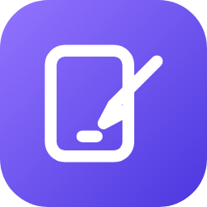
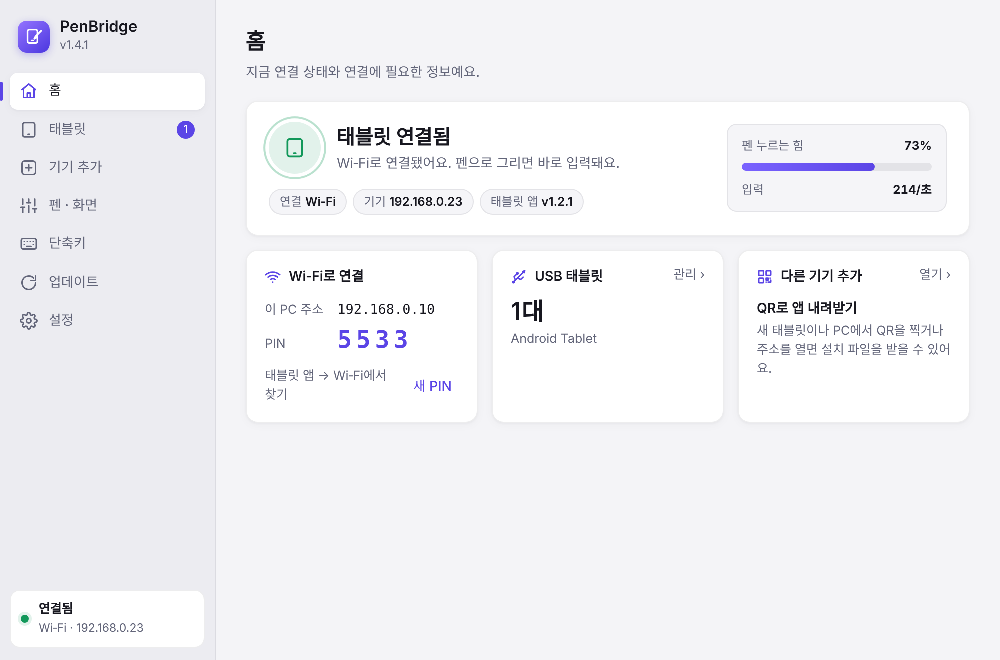
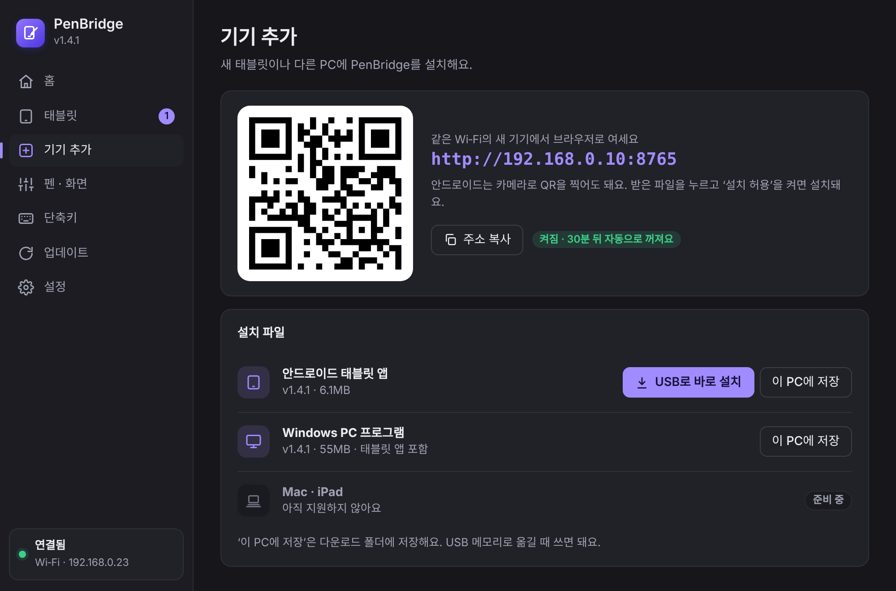
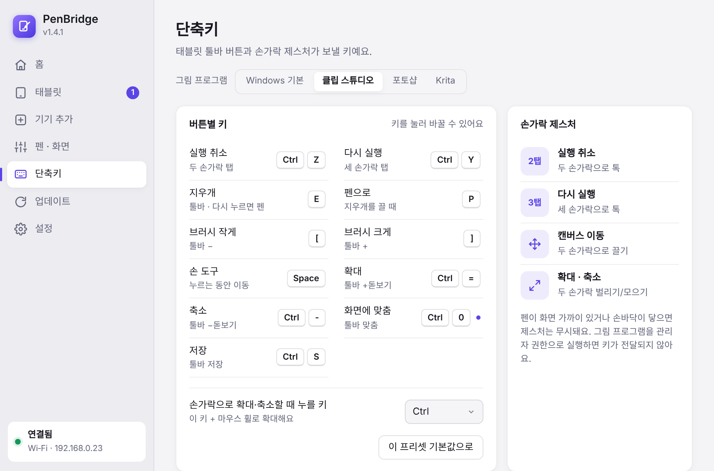
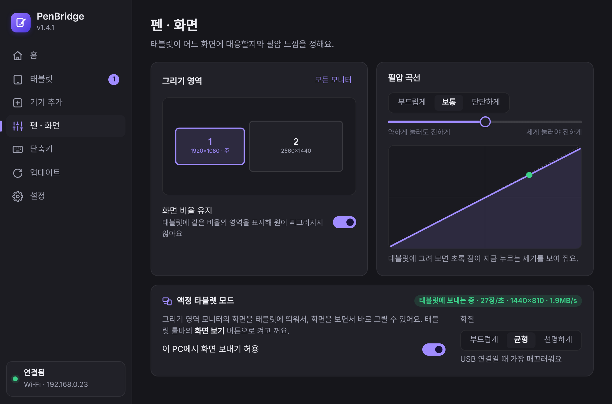
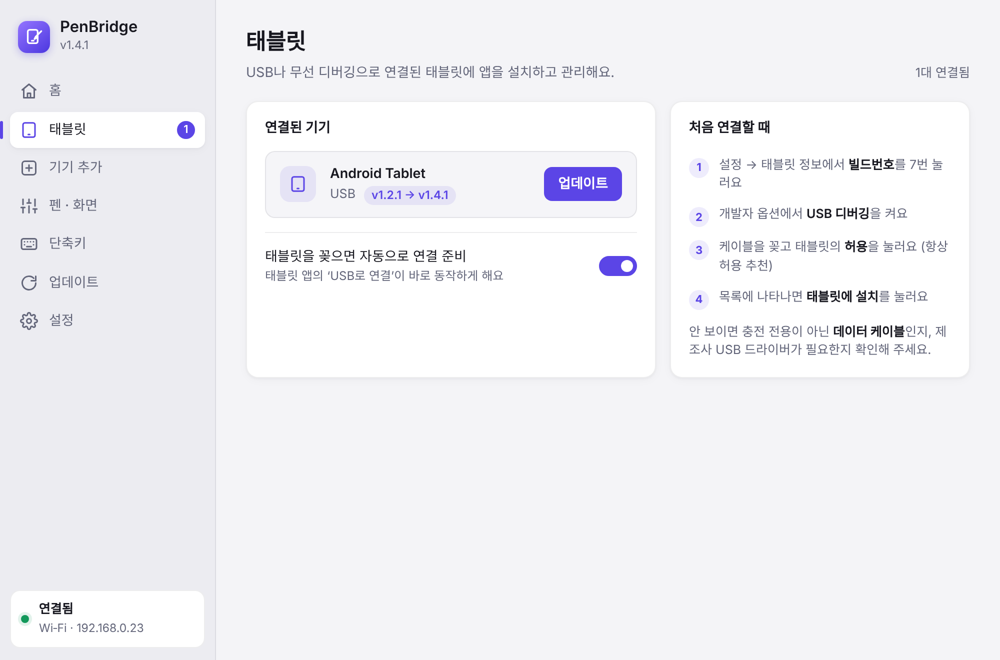
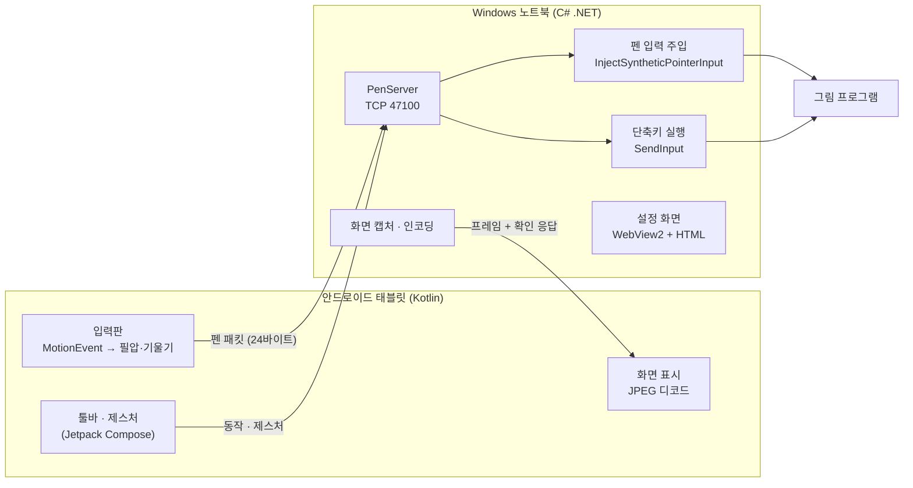

<div align="center">



# PenBridge

**안드로이드 태블릿을 Windows 노트북의 펜 태블릿 · 액정 타블렛으로**

필압 · 기울기 · 펜 버튼 · 지우개를 Windows의 **실제 펜 입력**으로 전달해서
클립 스튜디오, 포토샵, Krita 같은 그림 프로그램에서 그대로 쓸 수 있어요.

[내려받기 (Releases)](https://github.com/windkwk-rgb/wk-s-lab/releases?q=penbridge&expanded=true) · [동작 원리](docs/ARCHITECTURE.md) · [통신 규격](PROTOCOL.md)

</div>

---



## 주요 기능

| | |
|---|---|
| **진짜 펜 입력** | Windows `InjectSyntheticPointerInput`으로 필압(1024단계) · 기울기 · 사이드 버튼 · 지우개 끝을 전달. 그림 프로그램은 일반 펜 태블릿처럼 인식 |
| **USB · Wi‑Fi 연결** | USB는 `adb reverse`로 지연 최소화. Wi‑Fi는 자동 검색(UDP 브로드캐스트 + 서브넷 TCP 탐색) + PIN 보호 |
| **액정 타블렛 모드** | 노트북 화면을 태블릿에 실시간 표시하고 그 위에 바로 그리기. 한 장씩 확인 후 전송해서 지연이 쌓이지 않음 |
| **단축키 툴바 · 제스처** | 실행 취소/다시 실행 · 지우개 · 브러시 크기 · 손 도구 · 확대/축소. 두 손가락 탭 = 실행 취소, 핀치 = 확대. 클립 스튜디오/포토샵/Krita 프리셋 + 사용자 지정 |
| **기기 추가** | QR 코드 + 내장 웹 서버(`:8765`)로 새 태블릿·PC에 설치 파일 전달. USB로 태블릿에 바로 설치 |
| **자동 업데이트** | GitHub Releases · 로컬 패치 파일(exe/apk/zip, 소스 zip이면 자동 빌드)을 감지해 스스로 교체. 연결된 태블릿 앱도 함께 업데이트 |
| **설치 프로그램 내장** | exe 하나가 프로그램 + 설치 + 태블릿 앱(APK)을 모두 포함. 시작 메뉴 · 방화벽 · 제거 등록까지 한 번에 |
| **연결 기억** | 태블릿 앱이 노트북을 이름으로 기억하고 앱을 열면 자동 연결. IP가 바뀌어도 이름으로 다시 찾음 |

<table>
<tr>
<td></td>
<td></td>
</tr>
<tr>
<td align="center"><sub>기기 추가 — QR로 설치 파일 받기 (다크 모드)</sub></td>
<td align="center"><sub>단축키 — 그림 프로그램별 프리셋과 키 지정</sub></td>
</tr>
<tr>
<td></td>
<td></td>
</tr>
<tr>
<td align="center"><sub>펜 · 화면 — 모니터 선택, 필압 곡선, 액정 타블렛 모드</sub></td>
<td align="center"><sub>태블릿 — USB로 앱 설치 · 업데이트 · 실행</sub></td>
</tr>
</table>

## 구조



- **전송**: 24바이트 고정 크기 패킷, TCP_NODELAY. USB는 `adb reverse tcp:47100`으로 같은 코드가 케이블을 탐
- **입력 지연**: 안드로이드 `requestUnbufferedDispatch` + 과거 샘플(`historicalX`)까지 전송, 노트북은 받은 즉시 주입
- **UI**: 노트북은 WebView2 위의 HTML/CSS(라이트·다크 자동), 태블릿은 Material 3
- 자세한 설계 이유와 흐름은 [docs/ARCHITECTURE.md](docs/ARCHITECTURE.md)

## 기술 스택

- **Windows**: C# · .NET 10 · WinForms 호스트 + WebView2 UI · Win32 (Pointer Injection, SendInput, DWM) · 단일 exe 배포
- **Android**: Kotlin · Jetpack Compose (Material 3) · 커스텀 View 입력판 · PackageInstaller 자가 업데이트
- **빌드 · 배포**: Gradle · `dotnet publish` · GitHub Actions(APK → EXE에 포함 → Release) · PowerShell 원클릭 빌드 스크립트

## 사용 방법

1. [Releases](https://github.com/windkwk-rgb/wk-s-lab/releases?q=penbridge&expanded=true)에서 `PenBridge.exe`를 받아 실행 → 상단 **이 PC에 설치하기**
2. 태블릿에서 USB 디버깅을 켜고 케이블 연결 → 노트북 앱 **태블릿** 메뉴에서 **태블릿에 설치**
   (또는 **기기 추가**의 QR을 태블릿 카메라로 찍어서 설치)
3. 태블릿 앱에서 **USB로 연결** 또는 **Wi‑Fi에서 찾기** → 그리기 시작

필압이 안 먹으면 그림 프로그램의 태블릿 설정을 **Windows Ink**로 바꿔 주세요.

## 직접 빌드하기

```powershell
# Windows에서 (PenBridge 폴더 안): 필요한 도구(.NET SDK, JDK 17, Android SDK)를 자동 설치하고 APK + EXE를 만듦
.\PenBridge-build.bat
```

- 또는 `PenBridge/` 아래가 바뀐 채로 `main`에 push하면 GitHub Actions(`.github/workflows/penbridge.yml`)가 빌드하고,
  `version.txt` 버전의 Release(`penbridge-v버전`)가 없으면 새로 만들어요.
- 버전은 `version.txt` 한 곳에서 관리해요 (노트북 앱 · 태블릿 앱 공통).

## 폴더 구성

```
android/     태블릿 앱 (Kotlin, Compose)
windows/     노트북 앱 (C#, WebView2 UI는 windows/ui)
docs/        설계 문서 · 스크린샷
build.ps1    원클릭 빌드 스크립트
PROTOCOL.md  태블릿 ↔ 노트북 통신 규격
CLAUDE.md    AI 코딩 도우미용 프로젝트 안내
```

## 라이선스

[MIT](../LICENSE) · QR 코드 생성: [qrcode-generator](https://github.com/kazuhikoarase/qrcode-generator) (MIT)
