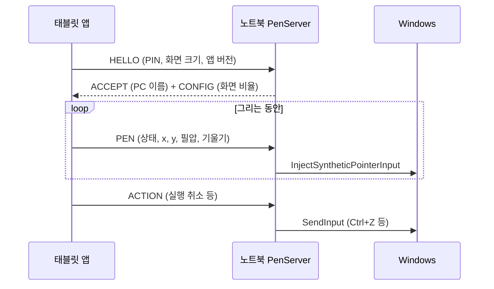
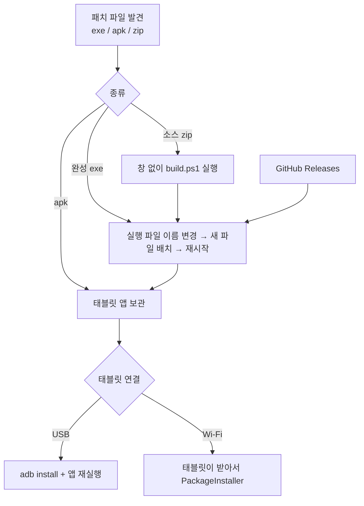

# PenBridge 설계

PenBridge가 어떻게 동작하고 왜 그렇게 만들었는지 정리한 문서예요.

## 1. 전체 흐름

## 2. 펜 입력

**태블릿 (`PenPadView.kt`)**
- `MotionEvent`에서 펜(STYLUS/ERASER)만 입력으로 쓰고 손가락·손바닥은 제스처 또는 무시
- `requestUnbufferedDispatch`로 화면 갱신 주기를 기다리지 않고 바로 이벤트를 받음
- `historicalX/Y`(프레임 사이의 샘플)까지 모두 보내서 빠른 선도 매끄럽게
- 좌표는 0~1로 정규화. 노트북 모니터 비율에 맞춘 "활성 영역"을 그려서 원이 찌그러지지 않음
- 안드로이드 기울기(수직에서 벌어진 각 + 방향) → Windows tiltX/tiltY(도)로 변환

**노트북 (`PenInjector.cs`)**
- `CreateSyntheticPointerDevice(PT_PEN)` + `InjectSyntheticPointerInput` → Windows가 진짜 펜으로 인식 (Windows Ink)
- 호버 → 접촉 → 떼기 → 범위 밖 상태를 추적해서 올바른 플래그 순서를 만듦
- 범위 밖에서 바로 접촉하면 거부되는 경우가 있어 호버 프레임을 먼저 보냄
- 필압 곡선(감마)을 노트북 쪽에서 적용 → 태블릿 앱을 바꾸지 않고 느낌 조절

## 3. 연결

| | 방식 | 이유 |
|---|---|---|
| USB | `adb reverse tcp:47100 tcp:47100` | 태블릿 앱은 `127.0.0.1`에 접속만 하면 됨 → Wi‑Fi와 같은 코드. 지연 가장 낮음 |
| Wi‑Fi 찾기 | UDP 브로드캐스트 + /24 TCP 탐색 동시 | 공유기·방화벽이 브로드캐스트를 막아도 TCP 탐색으로 찾음 |
| 보안 | Wi‑Fi는 4자리 PIN, USB는 생략 | 같은 네트워크의 다른 사람이 펜을 조작하지 못하게 |
| 재연결 | 1초 ping, 6초 무응답 시 끊음 → 자동 재접속 | 두 번 실패하면 PC 이름으로 다시 찾음 (IP 변경 대응) |

패킷은 모두 **24바이트 고정**이라 파싱이 단순하고, 쌓인 패킷을 한 번에 flush해서 시스템 호출을 줄여요.

## 4. 액정 타블렛 모드

- 별도 TCP 연결(`STREAM`)로 화면을 받음 → 펜 연결과 서로 막지 않음
- **한 장씩**: 노트북이 프레임을 보내고 태블릿이 `FRAME_ACK`을 보내야 다음 프레임 → 네트워크가 느려도 지연이 쌓이지 않음
- 화면 변화 감지(샘플 1,296점 비교) → 그대로면 보내지 않음 (가만히 있을 때 CPU·대역폭 거의 0)
- JPEG + 태블릿 비트맵 재사용(`inBitmap`)으로 GC 줄임
- 다음 단계: Desktop Duplication + 하드웨어 H.264(Media Foundation) → MediaCodec Surface 디코딩

## 5. 단축키 · 제스처

- 태블릿은 "무엇을 할지"(동작 번호)만 보내고, 어떤 키인지는 노트북이 프리셋/사용자 지정으로 결정
  → 그림 프로그램을 바꿔도 태블릿 앱은 그대로
- 지우개는 토글: 노트북이 상태를 기억해 지우개 키/펜 키를 번갈아 보내고 `TOOL_STATE`로 버튼 표시를 맞춤
- 손 도구는 누르는 동안 키를 누르고 있음, 떼거나 연결이 끊기면 반드시 뗌
- 제스처: 두/세 손가락 탭(350ms 이내, 움직임 14dp 이하), 이동은 휠, 확대는 수식키+휠(1.15배마다 한 칸)
- 손바닥(접촉 크기 42dp 초과)이나 펜 근접(500ms) 중에는 제스처 무시

## 6. 업데이트 · 배포

- 실행 중인 exe는 덮어쓸 수 없지만 이름은 바꿀 수 있음 → `.old`로 바꾸고 새 파일을 같은 자리에
- 태블릿 앱(APK)은 exe 안에 리소스로 포함 → exe만 배포해도 태블릿까지 업데이트
- APK 서명은 노트북 빌드와 GitHub 빌드가 같은 키를 씀 → 어디서 빌드해도 기존 앱 위에 업데이트 가능
- 다른 PC용 내보내기는 이 PC에 있는 PenBridge 중 가장 새 버전을 고름

## 7. 노트북 UI

- WinForms 창 + WebView2 + 내장 HTML 한 장. 디자인을 CSS로 빠르게 다듬고 브라우저에서 미리볼 수 있음
- C# → JS: 0.1초마다 상태 JSON(바뀐 경우만), JS → C#: 명령 메시지
- 라이트/다크는 `prefers-color-scheme` + 제목 표시줄은 DWM 속성으로 맞춤
- 트레이 아이콘: 대기(회색 선) / 연결됨(보라 + 초록 점)
