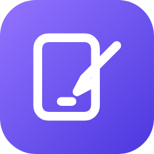
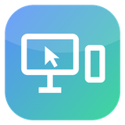
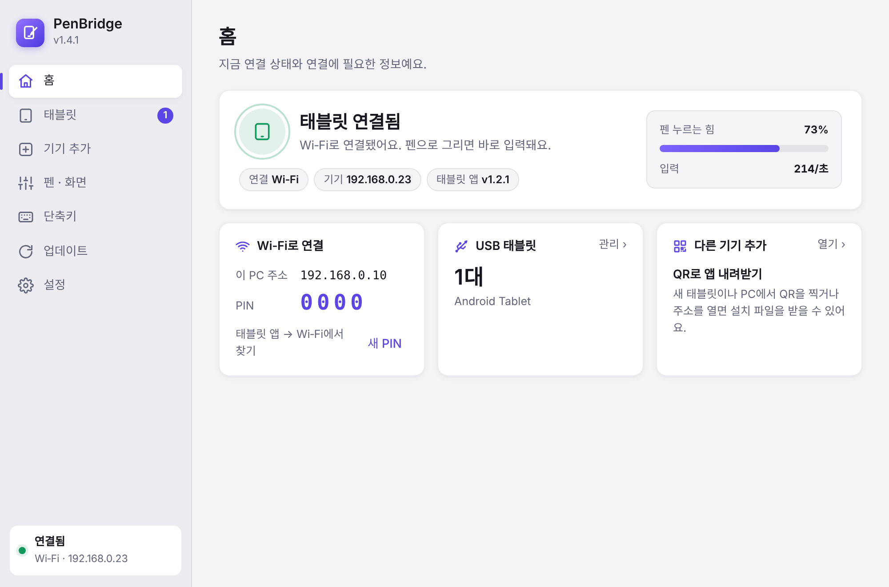
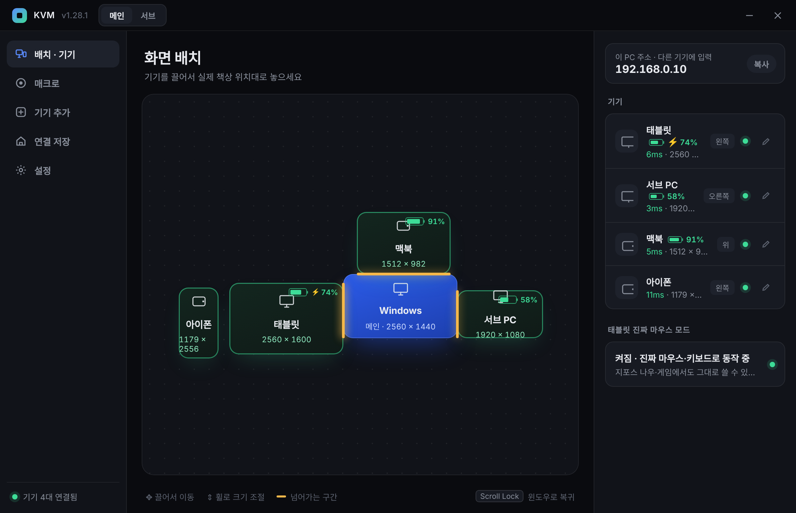
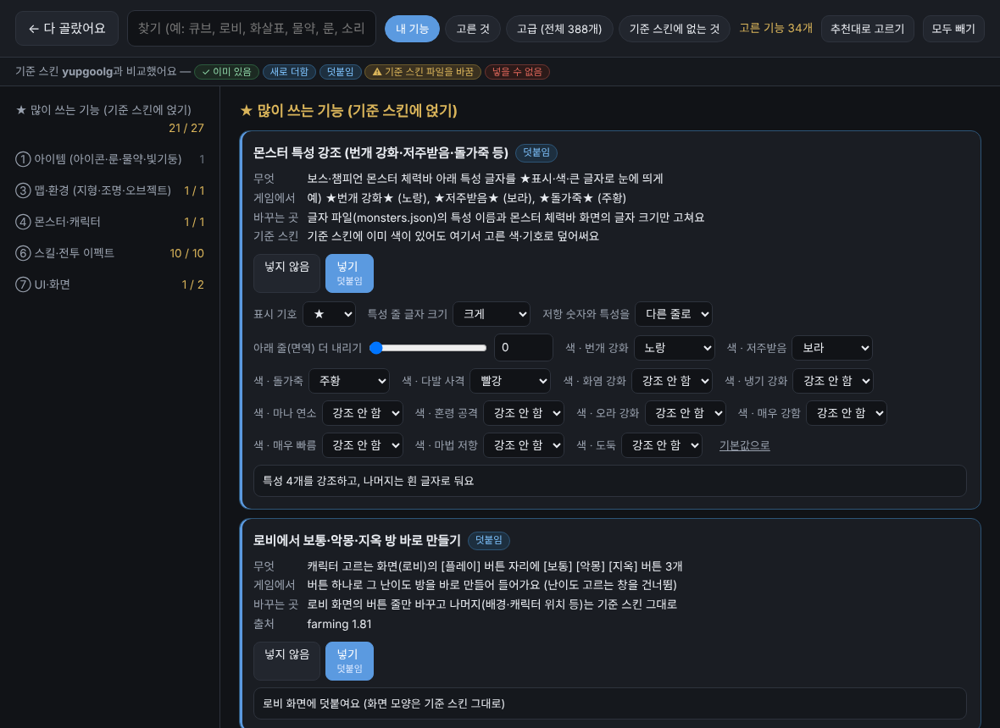

# wk's lab

직접 기획하고 만든 프로젝트를 모아 두는 저장소예요.
각 프로젝트는 자기 폴더 안에 코드 · 문서 · 빌드 방법을 모두 담고 있어요.

## 프로젝트

<table>
<tr>
<td width="96" valign="top"></td>
<td valign="top">

### [PenBridge](PenBridge/)
안드로이드 태블릿을 Windows 노트북의 **펜 태블릿 · 액정 타블렛**으로.
필압 · 기울기 · 펜 버튼을 Windows 실제 펜 입력으로 전달하고, 단축키 툴바 · 손가락 제스처 · 노트북 화면 미러링 · 자동 업데이트까지.

`C# .NET 10` `WebView2` `Win32 Pointer Injection` `Kotlin` `Jetpack Compose` `GitHub Actions`

[README](PenBridge/README.md) · [설계 문서](PenBridge/docs/ARCHITECTURE.md) · [내려받기](https://github.com/windkwk-rgb/wk-s-lab/releases?q=penbridge&expanded=true)

</td>
</tr>
<tr>
<td width="96" valign="top"></td>
<td valign="top">

### [SoftKVM](SoftKVM/)
키보드·마우스 하나로 **윈도우 PC · 서브 PC · 맥 · 안드로이드 태블릿 · 아이폰**을 오가는 소프트웨어 KVM.
화면 끝으로 밀면 옆 기기로 넘어가고, 매크로 녹화·실행 · 배터리 표시 · 장소별 연결 저장 · 설치 파일 배포 · 자동 업데이트까지.

`Python` `pynput` `pywebview` `PyInstaller` `Kotlin` `Android uhid` `Bluetooth HID` `GitHub Actions`

[README](SoftKVM/README.md) · [사용 설명](SoftKVM/docs/USER-GUIDE.md) · [내려받기](https://github.com/windkwk-rgb/wk-s-lab/releases?q=softkvm&expanded=true)

</td>
</tr>
<tr>
<td width="96" valign="top"></td>
<td valign="top">

### [D2R 스킨 빌더](D2RSkinBuilder/)
디아블로 II 레저렉션 **스킨(mpq)에 원하는 기능만 골라 얹는** 프로그램.
쓰던 스킨은 그대로 두고 미니맵 고정 · 몬스터 특성 강조 · 큐브 같이 열기 같은 기능을 덧붙여 새 스킨으로. 튕김 원인 찾기 · mpq로 업그레이드까지.

`Go` `MPQ (직접 구현)` `embed` `HTML/JS` `Python` `GitHub Actions`

[README](D2RSkinBuilder/README.md) · [동작 원리](D2RSkinBuilder/docs/ARCHITECTURE.md)

</td>
</tr>
</table>







## 구성

```
PenBridge/            태블릿 ↔ 노트북 펜 입력 브릿지
SoftKVM/              키보드·마우스 하나로 PC·맥·태블릿·아이폰 오가기
D2RSkinBuilder/       디아블로 II 레저렉션 스킨에 원하는 기능만 골라 얹기
.github/workflows/    프로젝트별 자동 빌드 · 릴리스 (태그: <프로젝트>-v<버전>)
```

## 라이선스

[MIT](LICENSE)
