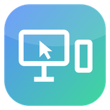
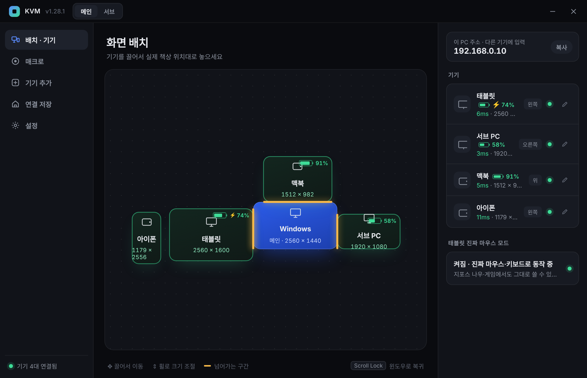
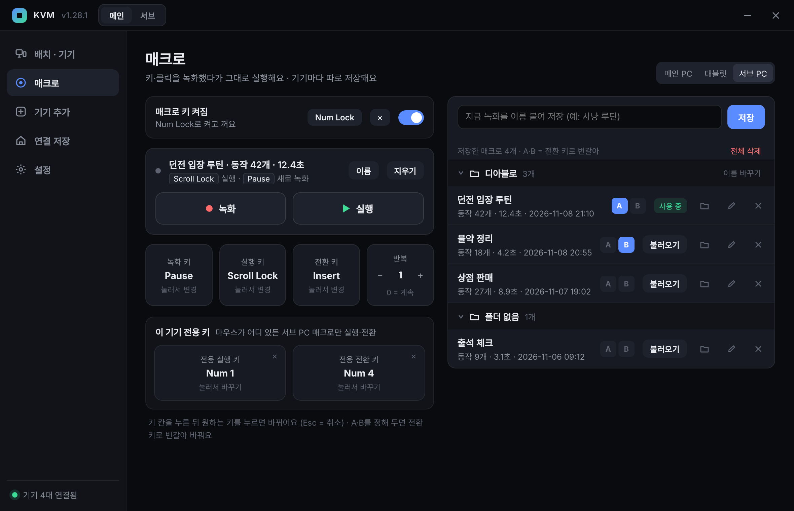
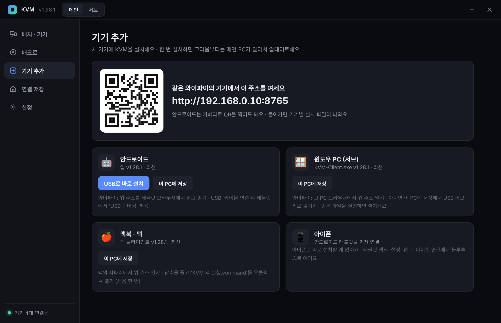
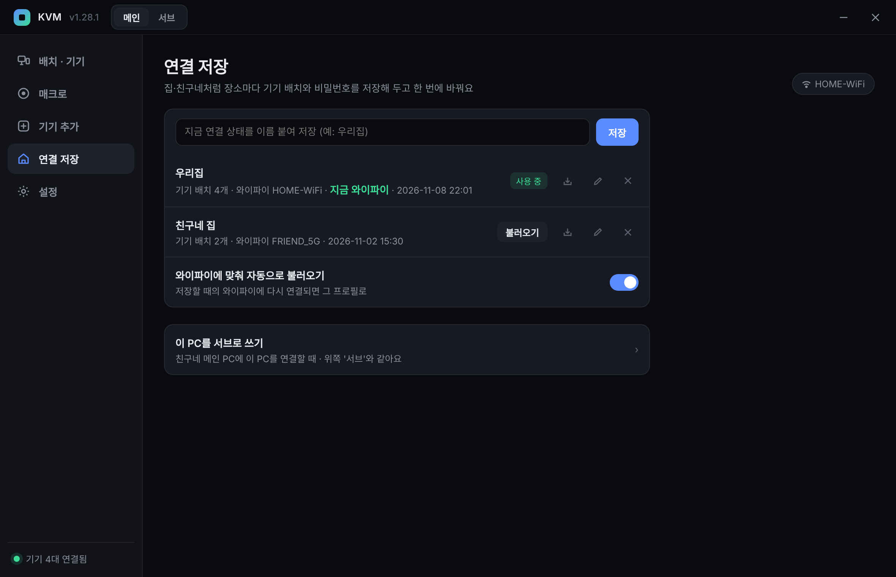
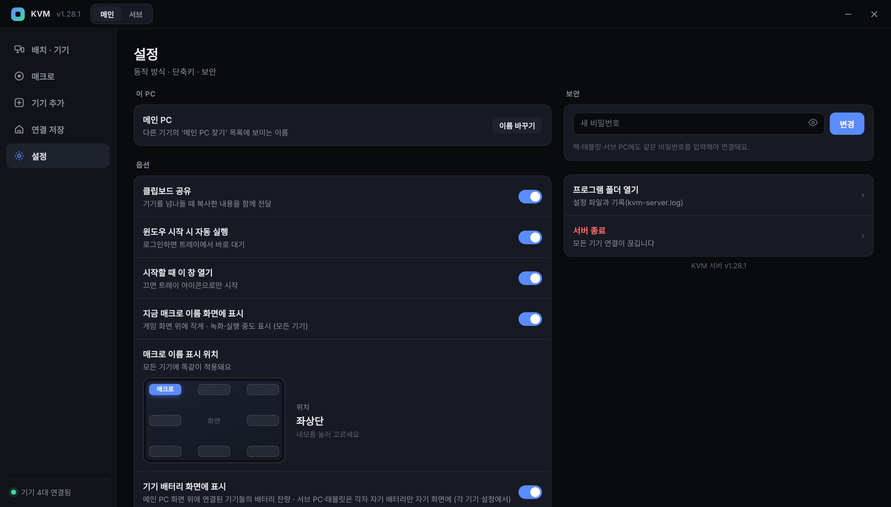
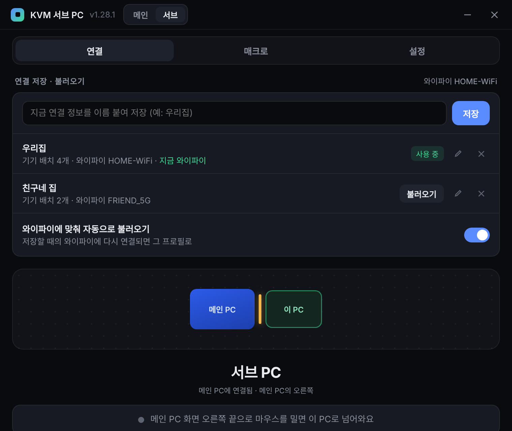
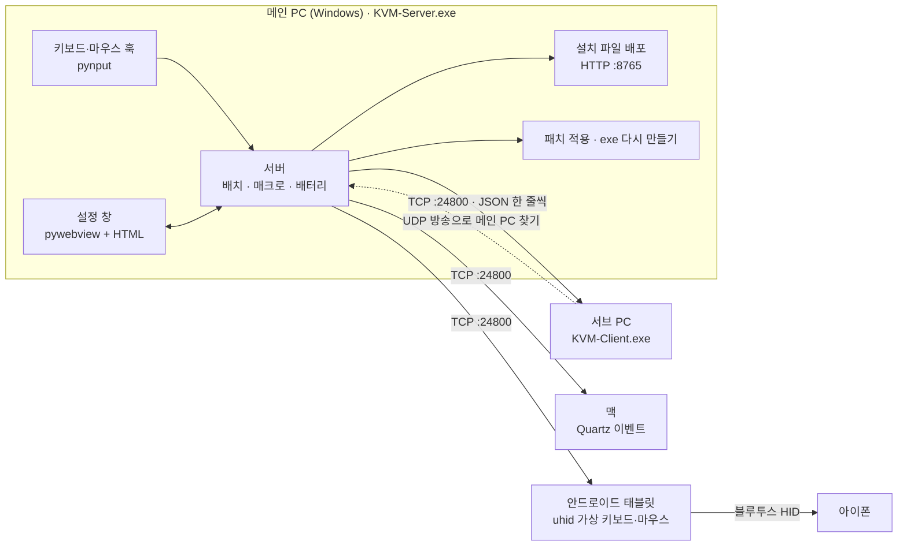

<p align="center"></p>

<h1 align="center">SoftKVM</h1>

<p align="center">
키보드·마우스 하나로 <b>윈도우 PC · 서브 PC · 맥 · 안드로이드 태블릿 · 아이폰</b>을 오가는 소프트웨어 KVM<br>
화면 끝으로 마우스를 밀면 옆 기기로 넘어가요. 매크로 · 배터리 표시 · 연결 프로필 · 자동 업데이트까지.
</p>

<p align="center">
<code>Python</code> <code>pynput</code> <code>pywebview</code> <code>PyInstaller</code> <code>Kotlin</code> <code>Android uhid</code> <code>Bluetooth HID</code> <code>GitHub Actions</code>
</p>

<p align="center">
<a href="https://github.com/windkwk-rgb/wk-s-lab/releases?q=softkvm&expanded=true"><b>내려받기</b></a> ·
<a href="docs/USER-GUIDE.md">자세한 사용 설명</a> ·
<a href="CLAUDE.md">개발 메모</a>
</p>



> 기기 상자를 끌어서 실제 책상 위치대로 놓으면, 그 방향 화면 끝으로 마우스를 밀 때 그 기기로 넘어가요.
> 노란 선이 넘어가는 구간이고, 각 기기의 배터리 잔량과 응답 속도도 함께 보여요.

## 주요 기능

| | 기능 | 설명 |
|---|---|---|
| 🖱️ | **화면 넘나들기** | 마우스를 화면 끝으로 밀면 서브 PC · 맥 · 태블릿 · 아이폰으로 넘어감. 클립보드도 같이 |
| 🤖 | **태블릿 진짜 마우스 모드** | 안드로이드 `uhid`로 실제 USB 키보드·마우스처럼 인식 → 게임·지포스 나우에서도 동작 |
| 📱 | **아이폰 중계** | 태블릿이 블루투스 키보드·마우스가 되어 아이폰을 조작 (아이폰에 설치할 것 없음) |
| 🇰🇷 | **한글 입력** | 태블릿에서 한/영 전환과 한글 조합을 직접 처리 |
| ⏺️ | **매크로** | 키·클릭을 녹화했다가 그대로 실행. 기기별 저장, 폴더, A/B 전환, 기기 전용 단축키(숫자 패드), 켜고 끄는 키 |
| 🏷️ | **화면 위 표시** | 지금 매크로 이름과 배터리 잔량을 게임 화면 위에 작게 (8곳 중 위치 선택, 클릭은 통과) |
| 🏠 | **연결 저장** | "우리집", "친구네 집"처럼 연결 정보를 저장했다가 불러오기. 와이파이에 맞춰 자동 전환 |
| ➕ | **기기 추가** | 같은 와이파이 기기에 QR·주소로 설치 파일 배포, USB로 태블릿에 바로 설치 |
| 🔄 | **자동 업데이트** | 메인 PC에 패치를 넣으면 새 exe를 만들고 서브 PC·태블릿·맥까지 알아서 업데이트 |
| 🔁 | **역할 전환** | 같은 프로그램에서 메인 ↔ 서브를 버튼으로 전환 |

## 화면

<table>
<tr>
<td width="50%"><br><b>매크로</b> — 기기를 골라 녹화·실행, 폴더와 A/B 전환, 기기 전용 키</td>
<td width="50%"><br><b>기기 추가</b> — QR을 찍거나 주소를 열면 기기별 설치 파일. 항상 최신 버전</td>
</tr>
<tr>
<td><br><b>연결 저장</b> — 장소별 기기 배치를 저장하고 와이파이에 맞춰 자동으로 불러오기</td>
<td><br><b>설정</b> — 화면 위 표시 위치를 그림으로 고르기, 비밀번호, 자동 실행</td>
</tr>
<tr>
<td colspan="2" align="center"><br><b>서브 PC</b> — 같은 와이파이의 메인 PC를 자동으로 찾아 연결 · 연결 · 매크로 · 설정 탭</td>
</tr>
</table>

<sub>스크린샷의 기기 이름·주소·와이파이 이름은 모두 예시예요.</sub>

## 구조



- **입력 흐름**: 메인 PC가 키보드·마우스를 가로채서, 커서가 넘어간 기기로 이벤트를 보내요. 기기 쪽 앱이 그 기기에 실제 입력으로 넣어요.
- **매크로**: 녹화한 동작을 기기별로 그 기기에 저장하고, 실행할 때는 그 기기에만 보내서 다른 기기의 마우스가 흐트러지지 않게 해요.
- **업데이트**: 메인 PC가 패치를 적용하면 서버를 멈추지 않은 채 새 exe를 만들고, 몇 초 만에 바꿔 끼운 뒤 다른 기기에도 새 버전을 보내요.

## 기술 스택

| 영역 | 사용한 것 |
|---|---|
| 메인 · 서브 PC | Python 3, pynput(전역 훅), ctypes(Win32 SendInput · 화면 정보), pywebview(HTML UI), pystray(트레이), tkinter(화면 위 표시줄), PyInstaller(단일 exe) |
| 맥 | Python 3, pyobjc (Quartz 이벤트 · Cocoa) |
| 안드로이드 | Kotlin, AccessibilityService, `uhid` 가상 HID, InputMethodService(한글), Bluetooth HID Device(아이폰 중계) |
| 배포 | GitHub Actions (exe · apk · 맥 zip 자동 빌드 → Release) |

## 사용 방법

1. [Release](https://github.com/windkwk-rgb/wk-s-lab/releases?q=softkvm&expanded=true)에서 **KVM-Server.exe**를 받아 키보드·마우스가 꽂힌 메인 PC에서 실행해요.
2. 설정 창의 **기기 추가**에 나온 주소나 QR로 다른 기기에 설치해요.
   - 서브 PC: `KVM-Client.exe` 실행 → 목록에서 메인 PC 고르기 → 비밀번호 입력
   - 태블릿: apk 설치 → 접근성 권한 허용 → 메인 PC 연결
   - 맥: zip을 풀고 `KVM 맥 실행.command` 우클릭 → 열기
   - 아이폰: 태블릿 앱 '설정' 탭에서 블루투스로 연결
3. **배치 · 기기** 화면에서 기기 상자를 실제 위치대로 끌어 놓으면 끝이에요. `Scroll Lock`을 누르면 언제든 메인 PC로 돌아와요.

자세한 설명은 [docs/USER-GUIDE.md](docs/USER-GUIDE.md)에 있어요.

> 키 입력은 같은 와이파이 안에서 비밀번호로만 보호되고 암호화되지는 않아요. 집처럼 믿을 수 있는 네트워크에서 써 주세요.

## 직접 빌드하기

Windows에서:

```bat
exe만들기.bat      :: KVM-Server.exe, KVM-Client.exe (Python 필요)
apk만들기.bat      :: KVM-Android.apk (JDK·Android SDK·Gradle을 처음 한 번 자동으로 받아요)
```

개발 중에는 `서버실행.bat` / `서브PC실행.bat`으로 Python 그대로 실행할 수 있어요.
`SoftKVM/` 폴더가 바뀐 채로 `main`에 올라가면 GitHub Actions가 네 가지 설치 파일을 만들고,
`VERSION.txt`가 새 버전이면 Release(`softkvm-v버전`)를 만들어요.

## 라이선스

[MIT](../LICENSE)
